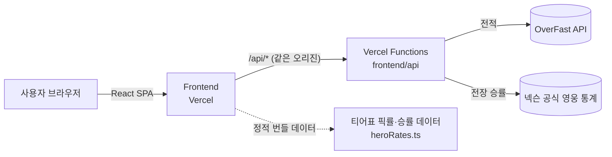

# WatchMeta


> 역할군별 **영웅 메타 티어표**와 내 **전적 분석**을 한 화면에서 제공하는 모바일 최적화 오버워치 웹 서비스

경쟁전에서 이기려면 지금 이 패치, 이 랭크, 이 서버에서 어떤 영웅이 강한지 아는 것이 가장 빠른 길입니다. WatchMeta는 이 질문에 답하는 것을 최우선 목표로 삼습니다 — 서버·랭크별 픽률·승률·밴률을 계산해 탱/딜/힐 역할군별 S\~D **메타 티어표**로 보여주고, 배틀태그 검색만으로 내 전적과 영웅별 세부 기록도 함께 확인할 수 있습니다.

**타겟 유저**: 오버워치를 즐겨 플레이하며 경쟁전 티어 상승에 관심이 많은 유저

---

## 주요 기능

### 🏆 메타 티어표 (핵심 기능)

역할군(탱/딜/힐)별로 영웅을 S\~D 티어로 분류해 보여주는 화면입니다. 서버(아시아/아메리카/유럽)와 랭크(브론즈\~그랜드마스터)를 바꾸면 해당 구간의 통계를 기준으로 티어가 다시 계산됩니다.

- **데이터 출처**: 블리자드 공식 [영웅 통계 페이지](https://overwatch.blizzard.com/ko-kr/rates/)에서 서버·랭크 조합별 픽률·승률·밴률을 수집해 [`heroRates.ts`](frontend/src/features/tier-list/data/heroRates.ts)에 정적으로 반영
- **티어 산정 로직** ([`tierList.ts`](frontend/src/features/tier-list/data/tierList.ts)): 영웅별 승률·픽률을 각각 0\~1로 정규화한 뒤 `메타 점수 = 승률 정규화값 × 0.5 + 픽률 정규화값 × 0.5`로 계산하고, 점수 순위를 `S 15% / A 25% / B 30% / C 20% / D 10%` 비율로 잘라 티어를 배정
- 패치 버전 선택 UI는 준비되어 있으나 아직 실데이터 연동 전 (다음 로드맵 항목)

### 🔍 전적 검색 & 프로필

배틀태그로 검색하면 서버리스 함수가 [OverFast API](https://overfast-api.tekrop.fr)를 조회해 경쟁전 티어, 총 플레이타임, 승률, KDA, 모스트 영웅을 보여줍니다. 프로필에서 특정 영웅을 선택하면 그 영웅만의 승률·KDA·플레이타임 등 세부 기록으로 이동할 수 있습니다.

### 📜 패치 노트

블리자드 공식 패치 노트를 정리해 영웅 밸런스 변경 사항을 카드 형태로 보여줍니다.

### 🕘 최근 검색 기록

검색한 배틀태그를 브라우저 로컬(Zustand `persist`)에 저장해 재검색·삭제할 수 있습니다.

---

## 아키텍처



- **API는 프론트와 같은 오리진**의 Vercel Functions(`frontend/api/`)입니다. 별도 호스팅이 없어 CORS 설정도, 깨어나길 기다리는 콜드 스타트도 없습니다.
- **전적 검색·프로필**은 OverFast API를 프록시합니다. 넥슨은 플레이어 조회를 제공하지 않아 이 경로만 OverFast를 씁니다.
- **전장 승률·전장 목록**은 넥슨 공식 영웅 통계(`overwatch.nexon.com/hero/rate`)를 프록시합니다. 메타 티어표와 같은 출처라 수치 기준이 일치하고, OverFast에 없는 **한국 지역**과 **전장별 밴률**을 쓸 수 있습니다. 응답은 `Cache-Control`로 Vercel CDN에 올려 반복 요청이 함수를 깨우지 않게 합니다.
- **메타 티어표**는 별도 API 호출 없이 프론트엔드에 번들된 정적 데이터를 클라이언트에서 그룹핑·정렬해 보여주는 구조입니다. 데이터 최신화는 [`heroRates.ts`](frontend/src/features/tier-list/data/heroRates.ts)를 갱신하는 방식으로 이뤄집니다.

---

## 기술 스택

| 영역 | 기술 |
| --- | --- |
| Frontend | React 19, TypeScript, Vite 8 |
| 스타일링 | Tailwind CSS v4 (`@tailwindcss/vite`) |
| 라우팅 | React Router v7 |
| 서버 상태 | TanStack Query |
| 클라이언트 상태 | Zustand (`persist` 미들웨어) |
| HTTP 클라이언트 | Axios |
| 아이콘 | lucide-react |
| Backend | Vercel Functions (Node) |
| 외부 데이터 | 넥슨 공식 영웅 통계 (티어표·전장 승률), [OverFast API](https://overfast-api.tekrop.fr) (전적 검색) |
| 배포 | Vercel (프론트엔드 + API 함수) |

---

## 프로젝트 구조

`frontend` 하나짜리 npm workspace입니다. 화면과 API 함수가 같은 패키지에 있고, `frontend/api/`가 배포 시 Vercel Functions가 됩니다.

```
WatchMeta/
├── frontend/
│   └── src/
│       ├── app/                    # 라우터(App Router), QueryClient 등 전역 Provider
│       ├── pages/                  # 라우트 단위 화면 (Home, Search, Profile, TierList, PatchNotes ...)
│       ├── features/               # 도메인별 로직 — 화면이 아니라 기능 단위로 응집
│       │   ├── tier-list/          #   ├─ data/  정적 픽률·승률 데이터 + 티어 산정 로직
│       │   │                       #   ├─ api/   백엔드 연동용 (현재 미사용, 로드맵 항목)
│       │   │                       #   └─ components, hooks
│       │   ├── player-search/      #   배틀태그 검색, 최근 검색 기록
│       │   ├── player-profile/     #   프로필 조회 API 연동, 영웅별 상세 스탯 카드
│       │   └── patch-notes/        #   패치 노트 정적 데이터 + 카드 UI
│       ├── components/             # 여러 feature가 공유하는 레이아웃 · 피드백 컴포넌트
│       ├── store/                  # Zustand 스토어 (최근 검색 기록 등)
│       ├── lib/                    # apiClient(Axios 인스턴스) 등 공용 클라이언트
│       └── types/                  # feature 간 공유되는 타입 정의
└── frontend/api/                # 배포 시 Vercel Functions (/api/*)
    ├── maps.ts                  # GET /api/maps — 경쟁전 전장 목록
    ├── map-stats.ts             # GET /api/map-stats — 전장별 영웅 승률·픽률·밴률
    ├── players/
    │   ├── search.ts            # GET /api/players/search
    │   └── [battleTag]/overview.ts
    └── _lib/                    # 함수들이 공유하는 코드 (_ 로 시작해 라우트가 되지 않음)
        ├── nexon.ts             #   넥슨 SSR 페이로드 파싱, 전장 목록·통계
        └── overfast.ts          #   OverFast 호출, 영웅 메타데이터 캐시
```

---

## API

API는 프론트와 같은 오리진의 Vercel Functions입니다(`frontend/api/`).

| 메서드 | 경로 | 설명 |
| --- | --- | --- |
| `GET` | `/api/players/search` | 닉네임으로 플레이어 후보 검색 |
| `GET` | `/api/players/:battleTag/overview` | 배틀태그로 경쟁전 티어, 플레이타임, 승률, 영웅별 스탯 등 프로필 데이터 조회 |
| `GET` | `/api/maps` | 경쟁전 전장 목록 (키, 한글 이름, 모드, 스크린샷) |
| `GET` | `/api/map-stats` | 전장별 영웅 승률·픽률·밴률. `map` / `region` / `division` 쿼리 |

출처가 두 갈래입니다. **전장 승률·전장 목록은 넥슨 공식 통계**(`overwatch.nexon.com/hero/rate`)를, **전적 검색은 OverFast**를 씁니다. 넥슨은 플레이어 조회를 제공하지 않고, OverFast에는 한국 지역이 없습니다.

---

## 시작하기

npm workspaces로 묶여 있어 루트에서 한 번만 설치하면 됩니다.

```bash
git clone https://github.com/kangjooy0ung/WatchMeta.git
cd WatchMeta
npm install
```

`.env`는 없어도 동작합니다. 다른 API를 붙여보고 싶을 때만 만듭니다.

```bash
cp frontend/.env.example frontend/.env   # VITE_API_BASE_URL — 비우면 같은 오리진의 /api
```

```bash
npm run dev           # http://localhost:5173 — 화면과 /api 함수가 함께 뜹니다
```

개발 서버는 `vite.config.ts`의 작은 미들웨어가 `/api/*` 요청을 `api/` 아래 함수 파일로 직접 넘깁니다. Vercel CLI나 별도 백엔드 프로세스가 필요 없습니다.

| 명령어 (루트에서 실행) | 설명 |
| --- | --- |
| `npm run dev` | 프론트엔드 개발 서버 실행 |
| `npm run build` | 프론트엔드 타입체크 후 프로덕션 빌드 |
| `npm run lint` | 프론트엔드 oxlint 린트 검사 |

`frontend/` 로 이동해 해당 `package.json`의 스크립트를 직접 실행해도 됩니다.

---

## 배포

**Vercel 하나로 끝납니다.** 프론트엔드와 API 함수가 같은 프로젝트에 있습니다.

- 모노레포 구조이므로 프로젝트 설정에서 **Root Directory를 `frontend`로 지정**해야 합니다. 그래야 `frontend/api/`가 `/api/*`로 서빙됩니다.
- npm workspaces로 `package-lock.json`이 루트 하나로 통합되어 있어, Vercel이 Root Directory 바깥의 lockfile을 읽도록 **"Include files outside of the root directory"** 옵션을 켜는 것이 안전합니다.
- 환경 변수는 필수가 아닙니다. `OVERFAST_BASE_URL`·`NEXON_BASE_URL`을 지정하면 출처를 바꿀 수 있고, 없으면 기본값을 씁니다.
- `vercel.json`의 rewrite는 `/api/`로 시작하지 않는 경로만 `index.html`로 보냅니다. 이 부정 패턴을 지우면 **API가 전부 SPA에 먹혀 404가 납니다.**

### 왜 별도 백엔드를 두지 않나

예전에는 Express 서버를 Render 무료 플랜에 따로 올렸습니다. 무료 플랜은 **15분 동안 요청이 없으면 서비스를 재우고**, 다음 요청이 깨우는 데 20~60초가 걸립니다(실측 21초). 전장 승률 페이지가 그 시간을 그대로 떠안아 첫 진입이 **약 28초**였습니다.

같은 오리진의 서버리스 함수로 옮기면서 그 대기가 사라졌습니다. 자주 쓰는 응답은 `Cache-Control`로 Vercel CDN에 올라가 **함수를 깨우지도 않습니다.**

---

## 로드맵 (6주 계획)

| 주차 | 목표 | 상태 |
| --- | --- | --- |
| 3주 | 오버워치 API 리서치 및 화면 흐름 기획 | ✅ 완료 |
| 4주 | 전적 검색 및 프로필 화면 구현, 실 데이터 연동 | ✅ 완료 |
| 5주 | 메타 티어표 실데이터 반영, 서버·랭크 필터 연동, 패치 노트 정리 | 🟡 진행 중 (패치 버전 필터 연동 예정) |
| 6주 | QA 테스트 및 Vercel 최종 MVP 배포 | ⚪️ 예정 |

---

## 수익 모델

기본 기능은 무료로 제공해 유저를 확보하고, 구글 애드센스와 같은 웹 배너 광고를 통해 유지보수 비용 및 수익을 창출합니다.
